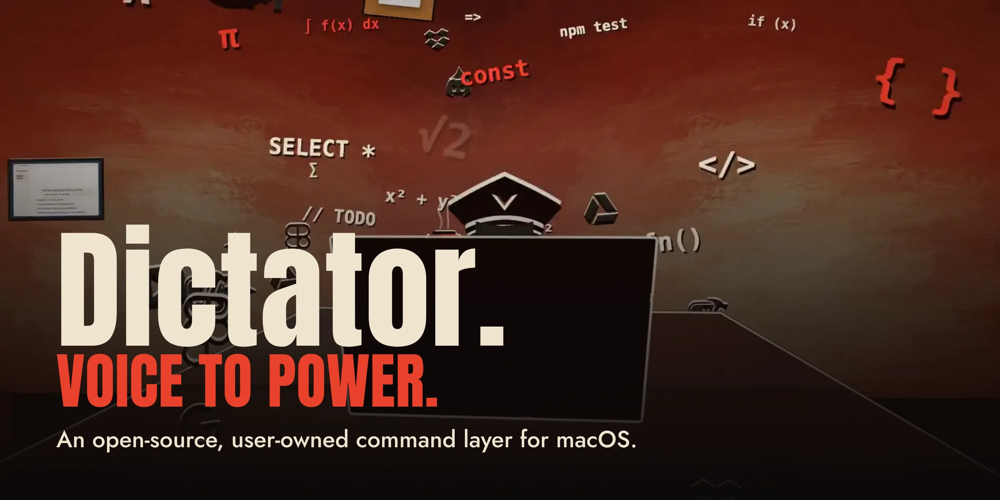
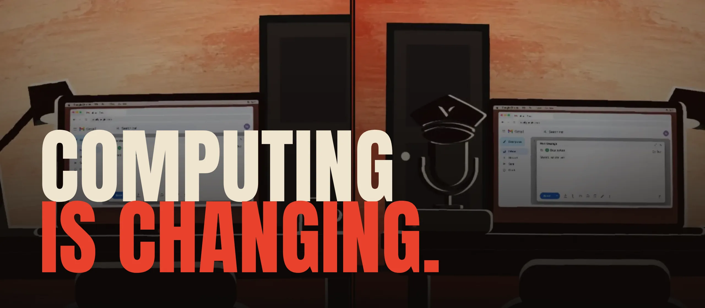
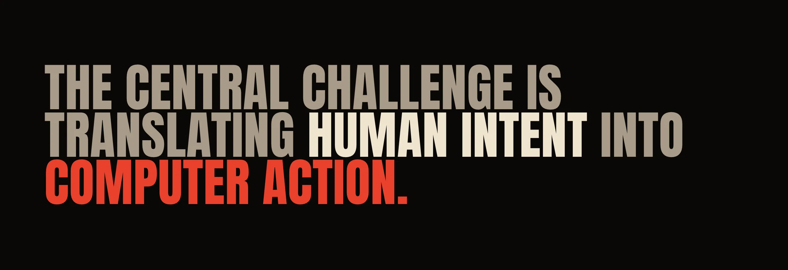
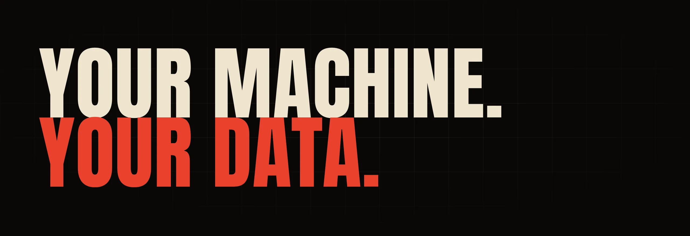
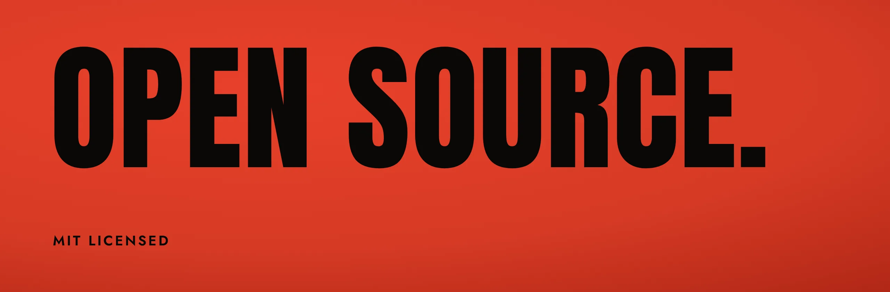
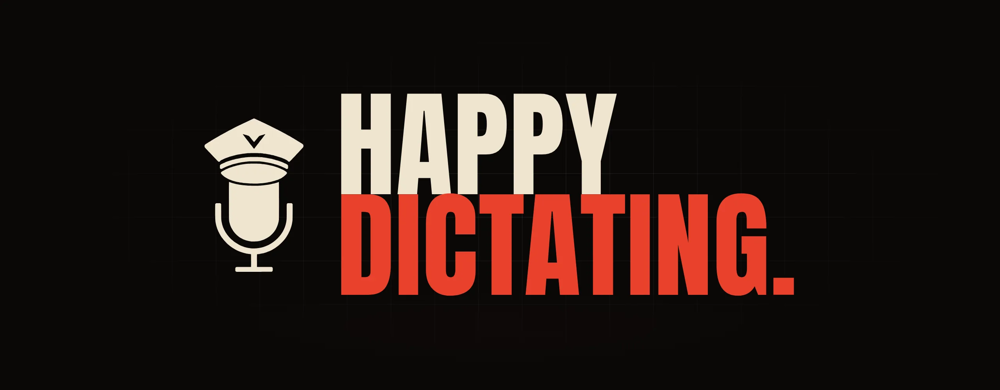

<p align="center">
  
</p>

```sh
curl -fsSL https://raw.githubusercontent.com/noamlittvock/dictator/main/install.sh | sh
```

<p align="center"><a href="https://github.com/noamlittvock/dictator/releases/latest"><b>Download for Mac</b></a></p>

<p align="center">Free and open source · MIT · macOS 14+ · Apple silicon</p>

<p align="center"><a href="#what-v1-ships-with">What V.1 ships with</a> · <a href="#your-machine-your-data">Your machine, your data</a> · <a href="#open-source">Open source</a> · <a href="#in-detail">In detail</a> · <a href="https://discord.gg/zVk555aYH">Join Discord</a></p>

<br>



We are moving from seeing computers as tools we operate to seeing them as digital environments where we manage, delegate, start automated work, and take the reins when direct control is needed.

Voice is central to this shift. It lets us do what comes naturally: say what’s on our minds and what we want done, instead of executing every step by hand.



## What V.1 ships with

Introducing Dictator: an open-source, user-owned command layer for macOS.

V.1 ships with out of the box local AI dictation, launching applications and projects by voice, workspace management, and configurable commands.

### 01 · Local AI dictation

<kbd>Right ⌥</kbd> hold, speak, let go

Clean text lands wherever your cursor is: Claude, Terminal, Gmail, Slack. Filler out, punctuation in. It learns your names from your corrections.

> **You say:** ~~um so like~~ on small phones the keyboard ~~uh~~ hides the invite button, fix it<br>
> **Claude gets:** On small phones the keyboard hides the Invite button. Fix it.

### 02 · Apps and projects

<kbd>Right ⌥</kbd> + <kbd>Right ⇧</kbd> say what you want

Name an app and it opens. Name a project and Claude Code starts in its folder with your request.

| You say | What happens |
|---|---|
| **Open** Xcode | Xcode opens. |
| **Code** pantry add an invite alert | Claude Code starts in your Pantry folder with the job. |
| **Claude** what should we build next | Claude opens with the question. |

### 03 · Workspaces

Say the name, or click it, or press its shortcut

Every app, tab and window where it belongs, on one Mac or all of them. Preview the layout before anything moves. Undo puts it all back.

> **Workspace** morning: the windows snap into place. **Workspace** writing: they swap.

### 04 · Commands you configure

Your phrase, your steps

Chain steps once and give them a phrase. It is matched exactly against your own lists, with no model guessing what you meant. Anything that sends waits for you.

> **You say:** **WhatsApp** Dana I’ll be late<br>
> **The command:** `WhatsApp [person] [message]`, with Dana as the person and I’ll be late as the message
>
> 1. Find Dana in your People list
> 2. Open the WhatsApp chat with the message typed
> 3. Wait. You press Send.

<br>


These are first steps toward one interface for directing tasks, automating routines and delegating work without giving up direct control.

*First steps, with no dates promised.* [Read the vision](docs/vision.md)

<br>

<a id="your-machine-your-data"></a>


Its engine runs entirely locally, keeping your data and prompts on your machine, allowing you to mine them for valuable insights on your usage patterns across vendors.

```text
DATASETS                     Saved · Mon 9:12
Sent to   Claude Code, Codex
Range     Last 30 days
Prompts   1,746
Run with  claude -p
Task      Find the prompts I keep repeating. For each, draft a slash
          command, a project rule or a Dictator command.
```

| Report | Prompt | Becomes |
|---:|---|---|
| 23× | run the tests and fix whatever fails | `/fix-tests`, slash command |
| 14× | review the diff for bugs before I commit | `/review`, slash command |
| 11× | no, use pnpm, not npm | `AGENTS.md`, project rule |
| 9× | open pantry, start the dev server and open localhost | `Pantry up`, Dictator command |

*The prompts and counts are illustrative.*

**Runs on your Macs.** Whisper or Apple’s speech engine hears you. An Ollama model tidies up. No cloud service hears your voice.

**Learn from your own prompts.** Datasets gathers your dictations and the prompts you type into the AI tools you connect, by vendor, project and date. Hand one to your own agent and ask what you keep repeating: the answers become slash commands, project rules and Dictator commands.

**One Mac, or all of them.** Dictate on the laptop and let the Mac mini do the heavy lifting. Your Macs find each other over Tailscale.

*Dictator prepares the data and never analyses it; the report comes from the agent you choose. What does go online: model downloads, update checks (you can turn them off), and whatever your commands open.*

<br>

<a id="open-source"></a>


Dictator is open source to encourage a community dedicated to exploring and improving human–machine interaction in the emerging new age of hybrid computing with the ultimate goal of unlocking the full power of personalized, intent-driven computing, on the user’s own terms.

**[Read the source](swift-client/)** · **[Open an issue](https://github.com/noamlittvock/dictator/issues/new/choose)** · **[Join Discord](https://discord.gg/zVk555aYH)** · MIT licensed

<br>



<p align="center"><b>Dictator V.1 is available now.</b></p>

```sh
curl -fsSL https://raw.githubusercontent.com/noamlittvock/dictator/main/install.sh | sh
```

<p align="center"><a href="https://github.com/noamlittvock/dictator/releases/latest"><b>Download for Mac</b></a></p>

<p align="center">macOS 14 or later · Apple silicon · Tailscale for more than one Mac</p>

---

# In detail

## Install

```sh
curl -fsSL https://raw.githubusercontent.com/noamlittvock/dictator/main/install.sh | sh
```

Or download `Dictator-1.1.0-macOS-arm64.zip` from the [latest release](https://github.com/noamlittvock/dictator/releases/latest), unzip it and drag Dictator to Applications.

The installer checks your Mac, verifies the downloaded release’s signature and Apple’s approval, puts Dictator in Applications, offers Ollama for clean-up models and Tailscale for more than one Mac, and opens the app. Downloaded releases keep their Developer ID signature and download quarantine; `DICTATOR_ASSET` is for local builds and permits local signing. In a terminal it asks before each step; `sh install.sh --help` lists them. On first launch Dictator's welcome walks through the dictation key, the Microphone, Accessibility and Input Monitoring permissions, and the speech model to download. `uninstall.sh` removes it again.

## Commands

Choose what happens when you speak. Turn on “Open an app”, then say “Open Safari”; “Workspace writing” runs the saved routine named writing. Hold Right ⌥ Option and Right Shift, or the keys you chose, say the phrase and release. Dictator matches it exactly against your own lists, with no model choosing the action.

Chain actions once and give them a phrase. The phrase selects the command, and the remaining words fill the actions you configured.

- “WhatsApp Dana I'll be late” opens a chat with Dana, message ready.
- “Code Atlas fix the login bug” opens the project and gives Claude Code your request.
- “Shortcut start my workday” runs the Apple Shortcut you made for your morning routine.

A command's actions can open a page or app, run a Workspaces routine, type, start a coding agent, press Return, run an Apple Shortcut, call a web address or add a line to a file. The editor adds a pause before sending actions so you can press Esc to cancel. You can opt out for Apple Shortcuts with Run right away or by marking one as “Doesn’t send or change anything”.

- **Run in the background.** A Terminal action can run a command with no terminal window. Spoken words reach it only as a quoted argument.
- **Use a keyboard shortcut.** Give a command one if it needs no spoken words.
- **Choose where it works.** Limit a command to certain apps, so one phrase can do different things in different apps.
- **Share commands.** Export commands to a file and import them. Imported commands arrive turned off. Export leaves out people's details and web addresses unless you choose to include them.
- **Start from other apps.** A command can opt in to being started through a `dictator://run` link. Commands that act ask first.
- **See what ran.** Home shows recent commands on this Mac: names and outcomes only, never your words.

## Workspaces

Create a window routine and run it by voice, with a click or a keyboard shortcut: the browser sits on the left and the editor on the right. With “Place apps”, assign each app to a Mac, a monitor on that Mac and a position on that monitor. Either Mac can start the routine; each opens and places its own apps. With “Open tabs”, a routine opens the pages you list in the browser you choose, on the Mac you choose, and in a named profile on Chrome-family browsers, so one routine can open your mail in one account and your documents in another. Turn on “Show only this routine’s windows” and a routine becomes a group: its windows come forward and other apps hide, on the same desktop, and running another group swaps them. Name your layouts and preview them before a window moves. Give a routine its own voice command right there, and run it with your chosen words even after its name changes. Undo uses the pre-run positions to move available windows back and reports any it cannot restore. It remains available until Dictator quits or a later run replaces it. Say “Workspace writing” in Commands mode to run the saved routine named writing. Its changes finish before the next command action begins. Choose whether a Place apps or Remember step opens closed apps. A missing monitor sends its windows to that Mac’s main screen; an unreachable Mac is named while the others finish. Undo leaves newly opened apps open. Remember how your windows are now, on this Mac or on all your Macs at once, and put them back later. Remember brings back only the minimized windows needed for its saved count; Place apps brings back one if none are visible. Undo minimizes those windows again. Windows on another desktop are left alone; switch to that desktop and run again to move them.

## Dictation

Hold Right ⌥ Option, or any key or combination you choose, speak and release. Dictator turns the recording into text and inserts it in the focused text field when the app allows it. Choose how far Dictator goes: clean up the text, which removes filler words and restores punctuation; polish it, which also fixes grammar and tightens sentences; or skip AI clean-up to keep the speech recognition result, if you prefer. Each dictation on Home shows what was done, and clicking that shows what was heard beside what was typed. This record stays on your Macs. Dictator helps with names and words from your fields, learns corrections, and uses your heard-as spellings. Each dictation is limited to 2 minutes; at the limit, what you said still goes on to transcription and insertion. Start another dictation to keep going.

The audio engine starts when Dictator opens and microphone access is allowed, so macOS may show the microphone as in use even while you are idle. Idle audio is neither saved nor sent. Audio buffers are discarded until you start recording: by holding the key, tapping it in tap mode, or using an explicit recording action such as Teach.

Learning from corrections is on by default. After Dictator inserts text, it checks the destination field through Accessibility once after insertion and once when you move on, start another dictation, or after 60 seconds. It compares changes to the dictated span to learn names; these checks do not keep a typing history. Secure fields and places excluded by your history rules are skipped, and Pause stops the checks. Learning carries on when history saving is off, because it keeps only filtered word pairs. A corrected sentence is saved only where your history rules allow typed text. Turn off Learn from corrections to stop the checks.

## Your Macs


Connect your Macs and choose their jobs: one keeps the record, one runs the models, and the Mac you press the key on records and receives the words. They find each other over Tailscale, at your desk or across the city, and keep shared settings in sync. The main Mac can serve from afar without a screen. Choose another Mac to record in Settings › Your Macs if that is your arrangement.

One keyboard over Universal Control is another option: slide your pointer to the next Mac and keep talking. Matching key presses tell Dictator the keyboard is shared, and pointer activity during that dictation can move where the words land. Separate keyboards work independently, wherever the Macs are. If a Mac becomes unreachable, dictation can use an available speech backup you have configured; otherwise it keeps the recording for recovery. Shared history waits for the main Mac to return.

| Role | What it does |
|---|---|
| On its own | One Mac, nothing shared. |
| Main Mac | Keeps the main copy of history, the dictionary and shared settings; other Macs connect to it. |
| Connected to a main Mac | Records, types and keeps its own copy of history; the main Mac decides what happens. |

Any Mac can run AI models: Whisper or Apple's speech recognition to turn speech into text, and Ollama models to clean it up. You choose which Mac does which job, and what takes over when a Mac is off. Startup is yours to set too: whether Dictator opens after login and whether its window appears, with the status of every Mac in your setup on one page.

## Your settings

- **Your words, spelled your way.** Dictator starts with common names and the words of your field, learns from your corrections, and keeps the words you star at the front.
- **Your models, on your machines.** Speech recognition runs on Whisper or Apple's engine, and clean-up on an Ollama model of your choosing. No cloud service hears your voice.
- **Your history, preserved.** When history saving is on, the speech engine's result, final dictation and matched correction are saved only where your history rules allow, and synced with connected Macs when they are reachable. Datasets lets you filter and prepare that history, export JSONL, JSON or CSV packages, and keep snapshots and reports over time. Analyze it with any tool you choose, or explicitly send a package to your own configured CLI. Optionally, Dictator also keeps what you type in apps you choose, with recognized passwords and keys hidden when hiding secrets is on.
- **Your recording, recoverable.** If something fails, Dictator explains the problem and keeps the audio so you can try again from Home or History & Privacy. Recovery recordings are removed at startup after 14 days; the oldest can be removed sooner to keep the total below 512 MiB.

## Questions

**Do I need more than one Mac?** No. One Mac is enough. If you have more, Dictator shares the work and keeps them in sync.

**How much can I customize?** The keys that start dictation and commands, keyboard shortcuts, models, clean-up, dictionary, commands, layouts and which Mac handles each job.

**Does anything go to the cloud?** Speech recognition and clean-up run on your Macs. Whisper and clean-up model downloads contact their hosts (Hugging Face and Ollama), macOS downloads Apple speech assets, and website icons are fetched from the websites themselves. A released copy checks GitHub for updates unless you turn off automatic checks in Settings › General. A command that opens a website or sends a message uses that service, as it would if you did it by hand. Datasets exports data only when you choose, and an explicitly configured CLI may use its own external service. Which ones do is your decision alone.

**Which models?** Whisper through WhisperKit (Large v3 Turbo down to Base, chosen by the memory your Mac has) or Apple's speech recognition on macOS 26, and Gemma, Qwen or Llama through Ollama for clean-up. Dictator downloads the Whisper and Ollama models you pick; macOS downloads Apple speech assets. Any Ollama tag can be typed. The list is in [`shared/model-catalog.json`](shared/model-catalog.json).

## Get started

1. **Install the app.** The one-liner above, or the zip from the release.
2. **Choose your keys.** Right Option starts dictation and Right Option plus Right Shift runs a command. Change either to any key or combination in Settings › General.
3. **Choose your models.** Whisper or Apple for speech; clean-up needs Ollama installed and a model downloaded.
4. **Try dictation.** Hold your key, speak and release. Then turn on a command in Commands or save a routine in Workspaces.

### Build from source

Xcode 16 or later and [xcodegen](https://github.com/yonaskolb/XcodeGen):

```sh
git clone https://github.com/noamlittvock/dictator.git
cd dictator/swift-client && xcodegen generate
xcodebuild -project Dictator.xcodeproj -target Dictator -configuration Release \
  CODE_SIGNING_ALLOWED=NO SYMROOT="$PWD/build" build
codesign --force --deep --sign - --entitlements Dictator/Dictator.entitlements build/Release/Dictator.app
DICTATOR_ASSET="$PWD/build/Release" ../install.sh
```

[docs/development.md](docs/development.md) covers signing with a stable identity (so permissions survive rebuilds), the tests, and the scripts.

### What's in this repository

| Folder | What it is | Status |
|---|---|---|
| `swift-client/` | The Mac app (SwiftUI). Everything above lives here. | Current |
| `server/` | The speech server: a Python service that runs Whisper and a clean-up model on one Mac. Optional, since speech models can run inside the app. | Current |
| `shared/` | Data both use: the catalog of apps and tools, the AI models offered in the app, the ready-made command templates and lists, capture connectors, and synthetic test audio. | Current |
| `scripts/` | Build, sign, install and server helpers. See [docs/development.md](docs/development.md). | Current |

- [docs/architecture.md](docs/architecture.md): how Dictator works. Macs and roles, the dictation pipeline, sync, AI models, typed history, Datasets.
- [docs/development.md](docs/development.md): building, signing, installing, running the tests, and what each script does.
- [docs/manual-testing.md](docs/manual-testing.md): checks to run by hand before a release.
- [docs/vision.md](docs/vision.md): the north star and where Dictator is going.
- [CONTRIBUTING.md](CONTRIBUTING.md): first contributions, building, tests and rules of the road.
- [server/README.md](server/README.md): the speech server.
- [AGENTS.md](AGENTS.md): rules for anyone, people or coding agents, changing this code.

---

<p align="center">© 2026 Noam Litt · Jerusalem<br>Code under the <a href="LICENSE">MIT License</a>. The Dictator name and artwork are not (<a href=".github/brand/README.md">details</a>). Third-party software and fonts are listed in <a href="THIRD_PARTY_NOTICES.md">THIRD_PARTY_NOTICES.md</a>.</p>
